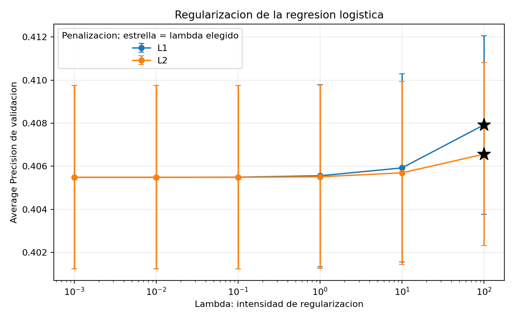

# Modelos supervisados de la Fase 1 con diez variables

**Proyecto 2 · Red Metropolitana · Autor: Adrián**
**Actualización:** 8 de noviembre de 2026.

## Datos y alcance

Esta actualización repite la comparación de la sección 1.4 con las diez variables del contrato v2. La entrada es `features.features_corte`, derivada de Silver, filtrada al corte A del 1 de julio de 2026 y ordenada por `unidad_id`. Los datos del proyecto son simulados.

La configuración entregada registra 59,515 unidades. La población de referencia de A contiene 7,098 positivos y 52,417 negativos: tasa positiva de 0.119264 (11.9264 %), consistente con el baseline de tasa. Las features corresponden a los 28 días anteriores al corte; la etiqueta identifica ausencia de abordajes válidos en los 30 días que comienzan en el corte.

Los scripts revisados consultan exclusivamente A para el modelado. Validan columnas, ausencia de nulos, claves duplicadas, etiquetas binarias y valores finitos. Estas comprobaciones no sustituyen la prueba de recorte de las features ni permiten afirmar que otro integrante no haya evaluado B.

## Variables predictoras

La fuente compartida es `scripts/modelos/variables.py`:

- `viajes_28d`
- `dias_desde_ultimo_viaje`
- `gasto_28d_q`
- `operadores_distintos_28d`
- `abordajes_fin_semana_28d`
- `viajes_7d`
- `dias_activos_28d`
- `gasto_promedio_viaje_q`
- `proporcion_hora_pico_28d`
- `tendencia_viajes_14d`

`unidad_id` y `fecha_corte` identifican filas; `etiqueta` es la respuesta. Ninguna de estas tres columnas entra como predictor. El baseline de ranking conserva únicamente la recencia.

## Métrica y validación

Se utiliza `average_precision_score` (Average Precision, AP), que resume precisión y recall a distintos niveles del ranking. Con el desbalance de A, predecir siempre continuidad daría aproximadamente 88.07 % de accuracy sin identificar ningún abandono. AP permite comparar el orden de riesgo antes de elegir el umbral. No es accuracy, ganancia económica ni área trapezoidal bajo la curva precisión-recall.

`crear_folds()` define `StratifiedKFold(n_splits=5, shuffle=True, random_state=42)`. Los scripts ordenan las unidades y las logísticas verifican sus particiones contra `asignacion_folds.csv`. `Pipeline` y `ColumnTransformer` ajustan `StandardScaler` únicamente con el entrenamiento de cada fold. La media y la desviación estándar muestral (ddof=1) se calculan sobre cinco folds; la desviación no es un intervalo de confianza.

Las métricas de A sirven para seleccionar hiperparámetros, por lo que pueden ser optimistas por selección. No son un test independiente ni sustituyen la evaluación temporal de B.

## Baselines

`baseline_tasa` asigna la tasa positiva de todo A, conforme a la definición adoptada en el proyecto. Usa etiquetas de todo A para esa constante: no se presenta como una estimación hecha únicamente con el entrenamiento de cada fold.

`baseline_ranking` usa `dias_desde_ultimo_viaje / 28`, sin ajuste. Su columna contractual se llama `prob`, pero es un puntaje de ranking sin calibración probabilística.

## Regularización y selección

Se compararon L1 y L2 con `solver="liblinear"`, `max_iter=5000` y semilla 42. La grilla fue λ ∈ {0.001, 0.01, 0.1, 1, 10, 100}, con C = 1/λ: doce configuraciones y sesenta ajustes de validación. Se selecciona la mayor AP media de validación; los empates exactos se resuelven por mayor λ y después L1.

| Penalización | Mejor λ evaluado | C | AP validación media | DE validación |
|---|---:|---:|---:|---:|
| L1 | 100 | 0.01 | 0.407921 | 0.004148 |
| L2 | 100 | 0.01 | 0.406560 | 0.004248 |

La logística seleccionada es **L1, λ=100, C=0.01**. La ventaja sobre L2 es 0.001360 de AP, una comparación descriptiva que no demuestra significancia estadística.

El mejor λ de ambas penalizaciones está en el extremo superior de la grilla. Se mantiene el espacio de búsqueda declarado y se reporta su mejor resultado; no se afirma haber encontrado el óptimo fuera de esa grilla. Esta limitación reduce el alcance de la comparación con la familia logística. Cualquier ampliación tendría que hacerse solo con A y antes de congelar el modelo y evaluar B.



Las barras del gráfico representan una desviación estándar entre folds.

## Resultados y lectura de sesgo y varianza

| Modelo | AP entrenamiento media | DE entrenamiento | AP validación media | DE validación | Brecha AP |
|---|---:|---:|---:|---:|---:|
| Baseline tasa | 0.119264 | 0.000012 | 0.119264 | 0.000046 | 0.000000 |
| Baseline ranking | 0.389339 | 0.000887 | 0.389760 | 0.003588 | -0.000421 |
| Logística L1 | 0.407812 | 0.001004 | 0.407921 | 0.004148 | -0.000108 |
| Logística L2 | 0.407126 | 0.001070 | 0.406560 | 0.004248 | 0.000566 |

La brecha es AP de entrenamiento menos AP de validación. L1 supera al ranking en 0.018161 de AP.

- **Tasa:** no distingue unidades; su desempeño limitado y brecha nula reflejan una regla constante.
- **Ranking:** aprovecha la recencia, pero queda limitado a una regla de una variable. La pequeña brecha negativa no es evidencia de fuga por sí sola.
- **L1:** brecha −0.000108 y mejor AP entre las logísticas evaluadas. No muestra una brecha importante de sobreajuste en esta evaluación.
- **L2:** brecha 0.000566, también pequeña, con menor AP que L1. Una brecha pequeña no garantiza capacidad suficiente ni buen desempeño futuro.

Estas interpretaciones son indicios; no constituyen una descomposición formal de sesgo y varianza.

## Coeficientes del ajuste con todo A

Tras seleccionar L1 se ajustó el pipeline con todo A para interpretar sus coeficientes. Ese ajuste no reemplaza las predicciones fuera de fold.

| Variable | Coeficiente | Odds ratio por desviación estándar |
|---|---:|---:|
| dias_desde_ultimo_viaje | 0.715911 | 2.046049 |
| viajes_28d | 0.000000 | 1.000000 |
| gasto_28d_q | 0.000000 | 1.000000 |
| abordajes_fin_semana_28d | 0.000000 | 1.000000 |
| tendencia_viajes_14d | 0.000000 | 1.000000 |
| proporcion_hora_pico_28d | -0.033848 | 0.966718 |
| gasto_promedio_viaje_q | -0.046771 | 0.954306 |
| operadores_distintos_28d | -0.052701 | 0.948663 |
| viajes_7d | -0.331825 | 0.717613 |
| dias_activos_28d | -0.504192 | 0.603994 |

Cada coeficiente se interpreta por un aumento de una desviación estándar de la variable, manteniendo constantes las demás. El odds ratio multiplica las odds, no la probabilidad.

**Solo un coeficiente es positivo:** la recencia, con 0.715911 y odds ratio 2.046049. No existen cinco coeficientes positivos para presentar como impulsores del abandono. Para la defensa se pueden explicar los cinco de mayor magnitud: recencia, días activos, viajes en siete días, operadores distintos y gasto promedio; los cuatro últimos tienen asociación negativa.

Días activos y viajes recientes se asocian con menores odds de abandono. La regularización L1 deja exactamente en cero cuatro coeficientes: viajes en 28 días, gasto total, abordajes de fin de semana y tendencia. Un cero no implica ausencia de relación en los datos: puede reflejar penalización y redundancia con otras variables. Las asociaciones no son causales; algunas variables derivadas están relacionadas entre sí.

## Tiempos y predicciones

Los cinco ajustes de L1 con λ=100 sumaron **0.607734 segundos**. Los sesenta ajustes de la búsqueda sumaron **10.647622 segundos**. Estas cifras proceden de `logistica_por_fold.csv` y no incluyen toda la lectura, predicción, generación de gráficos o el ajuste interpretativo final. El ZIP no contiene un registro del tiempo total de esta ejecución ni de las versiones efectivas de paquetes; no se reutilizan los tiempos o versiones del informe anterior.

`predicciones_cv.csv` conserva las columnas `unidad_id,fecha_corte,modelo,prob`. Para esta sección se esperan 59,515 filas por baseline y por logística: 178,545 filas para esos tres modelos. Después del ensemble, el archivo compartido debe contener 238,060 filas de cuatro modelos. La etiqueta `logistica` corresponde ahora a L1 con λ=100.

La verificación local confirmó 238,060 predicciones de cuatro modelos, con 59,515 unidades por modelo y únicamente la fecha 2026-07-01. No se encontraron nulos ni claves duplicadas; todos los puntajes son finitos y están entre 0 y 1. La asignación de folds coincide con la población, la semilla 42 y la versión anterior. Las medias y desviaciones de AP recalculadas desde las predicciones coinciden con las tablas publicadas.

## Reproducción y evidencias

Desde la raíz del repositorio, con el entorno acordado por el equipo:

```bash
python -m scripts.modelos.baseline --corte A
python -m scripts.modelos.logistica --corte A
```

Guardar una copia de `asignacion_folds.csv` antes del baseline y compararla después: el baseline vuelve a escribirla. Registrar las versiones reales del entorno utilizado para la entrega.

Evidencias: `busqueda_logistica.csv`, `logistica_por_fold.csv`, `comparacion_fase1.csv`, `coeficientes_logistica.csv` y `regularizacion_logistica.png`, en `scripts/modelos/`. Las medias y desviaciones de las logísticas seleccionadas se contrastaron con los registros por fold del ZIP.

La comparación con el ensemble está en [metricas_fase2_ensemble.md](metricas_fase2_ensemble.md) y la selección en [decision_modelo.md](decision_modelo.md).
