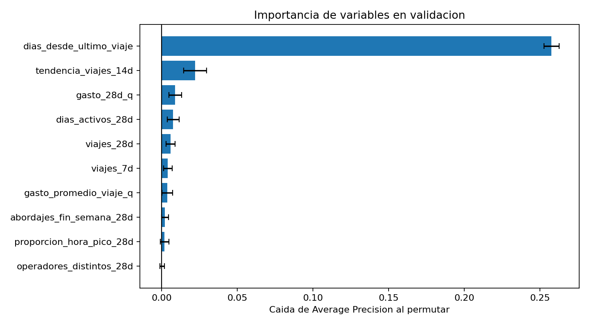

# Ensemble y comparación con diez variables

**Proyecto 2 · Red Metropolitana · Autor: Adrián**
**Actualización:** 8 de noviembre de 2026.

## Alcance y método

Se evaluó `HistGradientBoostingClassifier` sobre el corte A, 2026-07-01, con 59,515 unidades y las diez variables de `scripts/modelos/variables.py`. Se utiliza la misma definición de población y los cinco folds compartidos de las logísticas y baselines. El script verifica las particiones contra `asignacion_folds.csv`.

Cada fold entrena un pipeline nuevo; sus predicciones de validación se publican fuera de fold. `ColumnTransformer` selecciona las diez variables y conserva su escala original. Los scripts revisados restringen el modelado a A. No se utilizó B para redactar esta comparación.

## Configuración evaluada

| Parámetro | Valor |
|---|---:|
| learning_rate | 0.1 |
| max_iter | 100 |
| max_leaf_nodes | 15 |
| min_samples_leaf | 20 |
| l2_regularization | 1.0 |
| early_stopping | False |
| random_state | 42 |

La configuración permanece fija; no se hizo una búsqueda adicional para favorecer al ensemble. La API conserva `construir_pipeline()` sin argumentos y la lista compartida `VARIABLES`.

## Comparación con líneas base

| Modelo | AP entrenamiento media | DE entrenamiento | AP validación media | DE validación | Brecha AP |
|---|---:|---:|---:|---:|---:|
| Baseline tasa | 0.119264 | 0.000012 | 0.119264 | 0.000046 | 0.000000 |
| Baseline ranking | 0.389339 | 0.000887 | 0.389760 | 0.003588 | -0.000421 |
| Logística L1 | 0.407812 | 0.001004 | 0.407921 | 0.004148 | -0.000108 |
| Logística L2 | 0.407126 | 0.001070 | 0.406560 | 0.004248 | 0.000566 |
| Ensemble | 0.469742 | 0.001180 | 0.428920 | 0.002403 | 0.040822 |

La brecha es entrenamiento menos validación. Las desviaciones son muestrales entre cinco folds y no son intervalos de confianza. AP no es accuracy ni ganancia económica.

El ensemble supera a la mejor logística, L1 con λ=100, en **0.021000 de AP**, aproximadamente **5.15 % de mejora relativa**. Supera al ranking en **0.039160 de AP** y a la tasa en **0.309656**. La decisión se limita a las configuraciones efectivamente evaluadas: la logística obtuvo su mejor λ en el extremo superior de la grilla.

## Comparación por fold

| Fold | AP logística L1 | AP ensemble | Diferencia ensemble − L1 |
|---:|---:|---:|---:|
| 1 | 0.412010 | 0.426910 | 0.014900 |
| 2 | 0.409687 | 0.427828 | 0.018141 |
| 3 | 0.400967 | 0.426922 | 0.025955 |
| 4 | 0.408366 | 0.432126 | 0.023759 |
| 5 | 0.408573 | 0.430815 | 0.022242 |

El ensemble supera a L1 en los cinco folds, con diferencias de 0.014900 a 0.025955. Esto respalda la consistencia descriptiva de su ventaja en A, pero no prueba significancia estadística ni garantiza desempeño futuro; los entrenamientos de los folds se superponen.

## Sesgo y varianza

- **Baseline tasa:** desempeño limitado por no distinguir comportamientos; brecha nula por su regla constante.
- **Baseline ranking:** capta la recencia, pero su capacidad queda restringida a una variable y una regla fija; brecha −0.000421.
- **Logística L1:** brecha −0.000108; rendimiento similar en entrenamiento y validación, con límites por su estructura lineal regularizada.
- **Logística L2:** brecha 0.000566; poca diferencia entre entrenamiento y validación, aunque menor AP que L1.
- **Ensemble:** AP de entrenamiento 0.469742 frente a validación 0.428920; brecha **0.040822**, indicativa de sobreajuste respecto al entrenamiento. Aun así, obtiene la mejor AP de validación de las configuraciones comparadas.

Como referencia histórica, el informe de cinco variables reportó AP de validación 0.425788 y brecha 0.030199 para el ensemble. La nueva ejecución mejora la AP alrededor de 0.003132 y aumenta la brecha alrededor de 0.010622. Esta comparación histórica no aísla causalmente el efecto de añadir variables si cambió el entorno de ejecución. La selección actual se apoya en la comparación común de diez variables.

## Diez importancias por permutación

Se calculan exclusivamente sobre la validación de cada fold, con `scoring="average_precision"`, diez repeticiones, semilla 42 y un proceso. Se obtuvieron **500 registros: diez variables × cinco folds × diez repeticiones**. Se verificaron sus claves únicas y la correspondencia de medias y desviaciones con la tabla resumen.

| Variable | Caída media de AP | Desviación estándar |
|---|---:|---:|
| dias_desde_ultimo_viaje | 0.257674 | 0.005085 |
| tendencia_viajes_14d | 0.022059 | 0.007548 |
| gasto_28d_q | 0.008938 | 0.004134 |
| dias_activos_28d | 0.007558 | 0.003989 |
| viajes_28d | 0.005887 | 0.003015 |
| viajes_7d | 0.004060 | 0.002921 |
| gasto_promedio_viaje_q | 0.003683 | 0.003439 |
| abordajes_fin_semana_28d | 0.002158 | 0.002359 |
| proporcion_hora_pico_28d | 0.001902 | 0.002915 |
| operadores_distintos_28d | 0.000215 | 0.001511 |



La recencia sigue siendo la variable de la que más depende el modelo. La tendencia de viajes entre las dos mitades de la ventana aparece en segundo lugar, seguida por gasto y días activos. Que la tendencia tenga importancia en el ensemble y coeficiente cero en L1 es compatible con el uso de relaciones no lineales e interacciones por el ensemble, además de los efectos de la penalización.

Las importancias son caídas de AP, no porcentajes ni efectos causales. No indican dirección de asociación. La desviación combina variación entre folds y permutaciones; no es un intervalo de confianza. Las variables correlacionadas pueden compartir información y reducir sus importancias individuales. Los aportes de operadores distintos y otras variables pequeñas son inestables; no se eliminan automáticamente después de ver esta tabla.

La evidencia entregada contiene ahora las diez importancias requeridas; se sustituye la nota anterior que dejaba pendiente la ampliación de cinco a diez variables.

## Rendimiento

| Actividad | Segundos |
|---|---:|
| Entrenamiento acumulado de cinco folds | 2.152028 |
| Predicción de entrenamiento y validación | 0.679201 |
| Permutaciones en validación | 16.326503 |
| Ejecución total del script | 20.820056 |

La logística L1 seleccionada requirió 0.607734 segundos para sus cinco ajustes. El ensemble tarda más en entrenar, pero ambos costos son bajos en el equipo medido. Los tiempos son de una ejecución, no un benchmark repetido ni latencia de producción. No se compara el tiempo total del ensemble con toda la búsqueda logística como si fueran tareas equivalentes.

## Modelo seleccionado y traspaso

Se selecciona **ensemble con diez variables**, por su mayor AP y ventaja en los cinco folds, aceptando su mayor brecha y menor interpretabilidad. La decisión de modelado de Adrián está registrada en [decision_modelo.md](decision_modelo.md). No se atribuye una aprobación conjunta a Eduardo y Miguel sin su confirmación.

Eduardo debe recalcular y congelar el umbral usando las predicciones nuevas de A. El umbral anterior de 0.33 y su ganancia no se trasladan automáticamente a esta versión. Miguel debe entrenar y guardar el modelo final con todo A usando exactamente la configuración y variables seleccionadas. Modelo y umbral deben quedar registrados antes de la evaluación única en B.

## Predicciones y verificación del archivo compartido

El contrato final de `predicciones_cv.csv` es `unidad_id,fecha_corte,modelo,prob`: cuatro modelos (`baseline_tasa`, `baseline_ranking`, `logistica`, `ensemble`), 59,515 unidades por modelo y 238,060 filas, solo 2026-07-01. El ranking conserva un puntaje no calibrado.


## Reproducción

```bash
python -m scripts.modelos.baseline --corte A
python -m scripts.modelos.logistica --corte A
python -m scripts.modelos.ensemble --corte A
```

Entregar el CSV solo después de terminar la secuencia completa. Las evidencias están en `scripts/modelos/`: `comparacion_fase2.csv`, `ensemble_por_fold.csv`, `importancias_ensemble.csv`, `importancias_ensemble_detalle.csv`, `importancias_ensemble.png` y `configuracion_ensemble.json`. Registrar las versiones efectivas del entorno; no se incluyeron en el paquete revisado.
